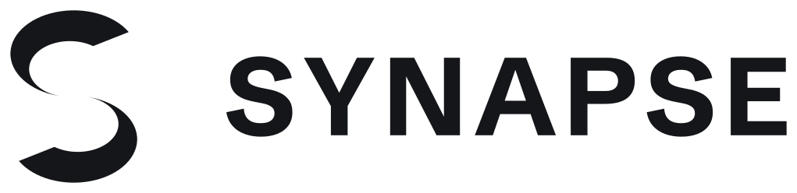
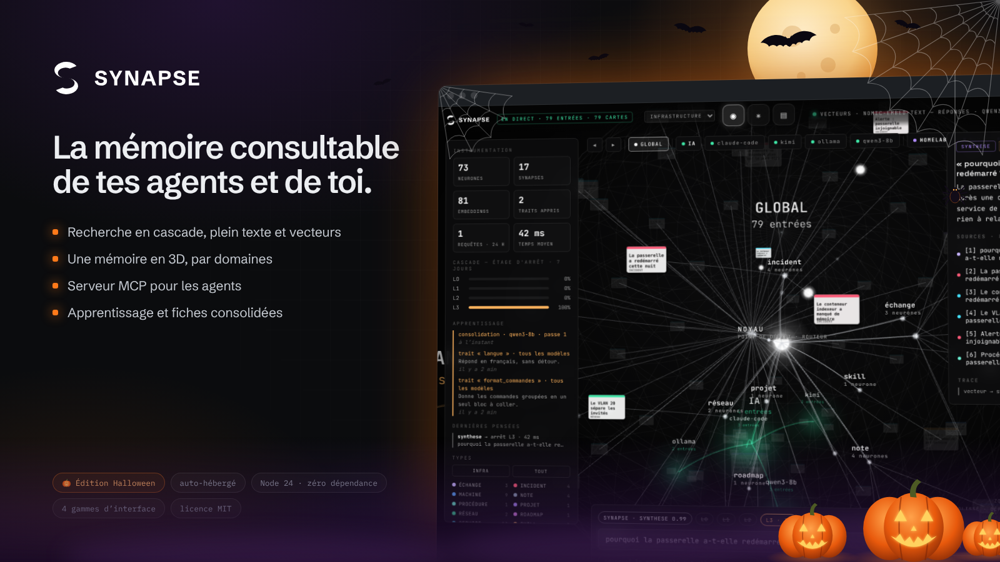
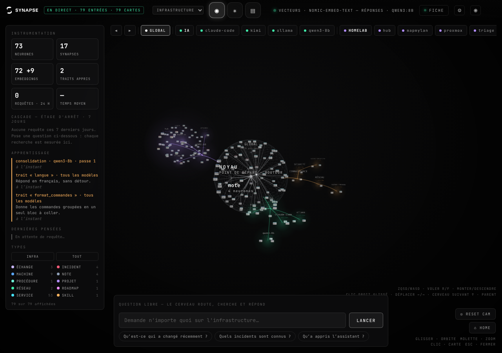
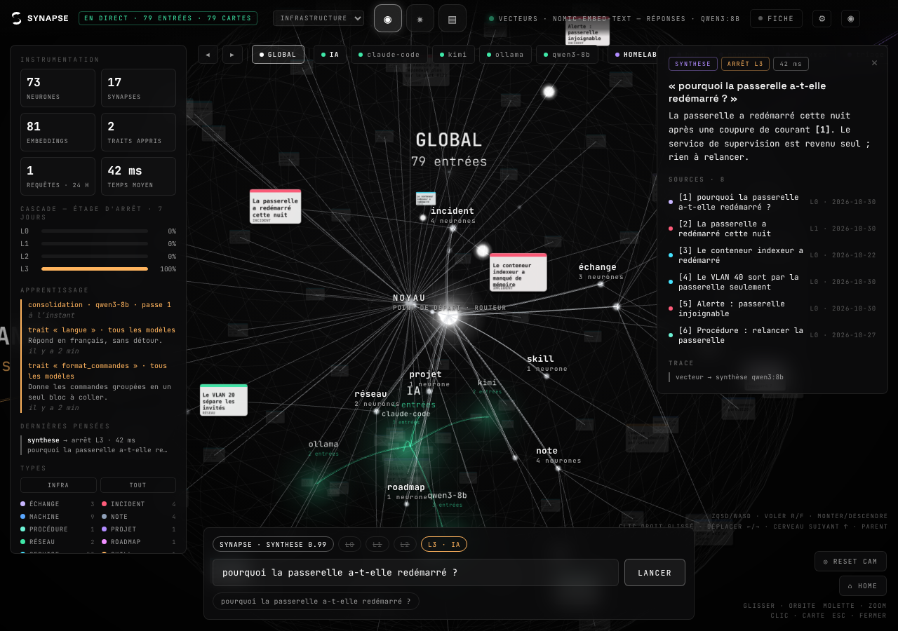
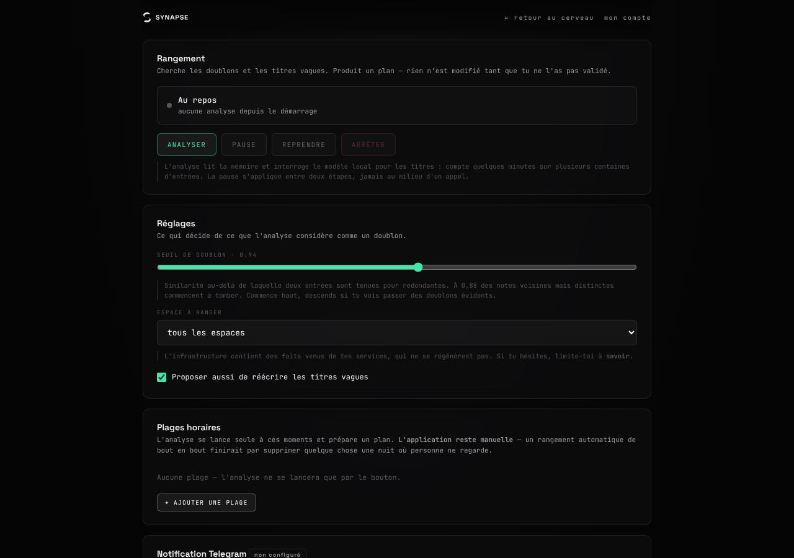

<p align="center">
  <picture>
    <source media="(prefers-color-scheme: dark)" srcset="medias/logo-sombre.svg">
    
  </picture>
</p>

<p align="center"></p>

# Synapse

**A searchable memory for AI agents and humans — cascade search, MCP server, and a 3D view of everything your memory contains.**

<p align="center">

[](https://github.com/Nesaris/Synapse/stargazers)
[](LICENSE)


</p>

<p align="center"><a href="README.fr.md">Full documentation</a> · <a href="https://nesaris.github.io">Nesaris Network</a></p>

## Why Synapse?

An agent diagnosing an incident, a human looking for a decision made six months ago, an assistant that must follow an in-house standard — they all ask *what do we already know?* and start from zero. Synapse is that place to look. Not a search engine: a memory that tells you when it doesn't know.

## Features

- **Cascade search** (L0 → L3) that answers from the cheapest level that knows, and says so when nothing does.
- **MCP server** so Claude, Codex or any MCP client can read and write the memory.
- **Brain hierarchy** — separate "brains" per project or team.
- **3D interface** to explore what the memory contains.
- **Node.js, zero dependencies, SQLite**, encrypted backups, Telegram integration.

## Screenshots

<table>
<tr><td align="center" width="50%"><br><sub>Memory in 3D</sub></td><td align="center" width="50%"><br><sub>An answer from memory</sub></td></tr>
<tr><td align="center" width="50%"><br><sub>Settings</sub></td></tr>
</table>

## Quick start

```bash
git clone https://github.com/Nesaris/Synapse && cd Synapse
cp .env.example .env
mkdir -p secrets && openssl rand -base64 32 > secrets/socle_cle && : > secrets/socle_cle_ancienne
sudo chown 10001:10001 secrets/socle_cle secrets/socle_cle_ancienne && sudo chmod 400 secrets/socle_cle secrets/socle_cle_ancienne
docker compose up -d --build
```

No default account: Synapse prints a one-time setup token in its logs, to paste on `/connexion`.

Full documentation (configuration, backups, key rotation, reverse proxy, upgrades) is in **[README.fr.md](README.fr.md)**.

## Part of Nesaris Network

Synapse is one of the self-hosted tools of **[Nesaris Network](https://nesaris.github.io)**. Every service shares the same hardened core (accounts, passkeys, TOTP, audit log, encrypted secrets), runs on Node.js 24 with **zero npm dependencies**, and can be installed in one click from the **[Nesaris Hub](https://github.com/Nesaris/Hub)**.

Other projects: [Hub](https://github.com/Nesaris/Hub) · [MapMyLAN](https://github.com/Nesaris/MapMyLAN) · [NexArc](https://github.com/Nesaris/NexArc) · [ProxLab](https://github.com/Nesaris/ProxLab) · [Vigie](https://github.com/Nesaris/Vigie) · [Relay](https://github.com/Nesaris/Relay) · [Nesmail](https://github.com/Nesaris/Nesmail) · [Dialekt](https://github.com/Nesaris/Dialekt)

## Contributing

Issues and pull requests are welcome. If Synapse is useful to you, a ⭐ helps a lot — it's how other people find the project.

## License

[MIT](LICENSE) — made by [CodeX64](https://codexx64.github.io).
